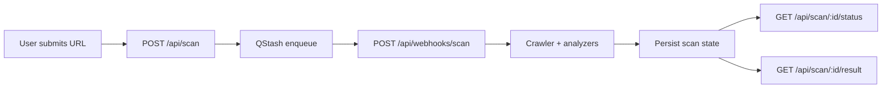

<p align="center">
  
</p>
<h1 align="center">AuditAI · Pip</h1>
<p align="center">
  <strong>Small companion. Stronger pages.</strong><br>
  A free SEO assistant for careful page audits, useful fixes, and private field notes.<br>
  No signup, payment, or API keys.
</p>
<p align="center">
  <a href="https://audit-ai-app.vercel.app"><strong>Visit Pip</strong></a>
  · <a href="https://github.com/Waqar-743/Audit_AI/releases/download/pip-v1.0.0/auditai-pip.zip"><strong>Download the Chrome extension</strong></a>
  · <a href="https://github.com/Waqar-743/Audit_AI/releases/tag/pip-v1.0.0">Release notes & assets</a>
</p>

## Pip: the free SEO assistant and Chrome extension

Pip welcomes visitors on the homepage and provides the full assistant at `/assistant`. No signup, payment, external AI service, or provider keys are required. It shares deterministic, evidence-based audit rules with the local Chrome extension and uses the website's existing charcoal, warm-white, and lime colors.

```bash
npm ci
npm run dev
```

Open `http://localhost:3000`. Enter a public page address to start an audit, or open `/assistant` directly. The development and production build commands also generate the extension download. The original URL scanner remains available in the homepage's **Looking for the original AI-readiness scanner?** disclosure, with its existing API and report routes preserved.

The homepage follows Pip's egg-to-flight story: bring a page, understand the evidence, make a useful change, and return to your field notes. An optional name and work goal personalize the welcome and guidance, using the assistant's existing local preferences without deleting saved reports. Mobile navigation, keyboard controls, native expandable FAQs, and readable server-rendered content keep the journey accessible.

### Website branding and search metadata

Pip's original parrot SVG appears in website branding and the browser icon. Matching generated assets include an Apple home-screen icon, favicon, and 1200×630 social preview. Regenerate these checked-in assets after changing the SVG:

```bash
node scripts/create-site-branding.mjs
```

Public pages have descriptive titles, descriptions, canonical URLs, and sharing metadata. The homepage includes factual Organization, WebSite, and free WebApplication JSON-LD, without invented ratings or ranking promises. `/sitemap.xml` lists the homepage, assistant, and privacy page; `/robots.txt` links to it. Individual scan reports and assistant URLs containing audit targets use `noindex`. Audit targets are removed from the address bar when a homepage audit starts. The canonical production origin is configured in `src/lib/site.ts`.

- **Page audit:** indexing instructions, titles and descriptions, canonicals, headings, image alternatives, link names, and JSON-LD syntax, with evidence and reference links.
- **Workbench:** edit a title and description, preview a possible snippet, and copy escaped metadata or a generic WebPage JSON-LD draft. No changes are automatically published.
- **Field notes:** optional personalization, 15 original bird illustrations, and the latest 20 reports saved in this browser, with export and delete controls.
- **Local coach:** asks and answers from observed findings through deterministic topic matching. It does not call an AI provider or fabricate ranking data.
- **Chrome extension:** reads the rendered DOM locally after an explicit audit action. Includes temporary element highlights and makes no network requests.

The website URL audit reads initial public HTML with bounded, DNS-pinned HTTP requests and redirect validation. It does not execute target JavaScript. The extension reads the current rendered page. Each report states its extraction mode and limitations. The checklist score counts passed pass/fail checks and excludes reviews and untested areas; it is not a ranking or AI-citation prediction.

### Download and install the extension

Download [auditai-pip.zip from the Pip v1.0.0 release](https://github.com/Waqar-743/Audit_AI/releases/download/pip-v1.0.0/auditai-pip.zip). You do not need Node.js or the source code to use this download.

1. Extract the ZIP into a permanent folder on your computer.
2. Open `chrome://extensions` in Chrome 120 or later.
3. Enable **Developer mode**, click **Load unpacked**, and choose the extracted folder containing `manifest.json`.
4. Pin **AuditAI · Pip SEO assistant** to the toolbar.
5. Visit a webpage, click Pip's toolbar icon, then select **Audit this page**.

Keep the extracted folder: Chrome loads the extension from that location. To update a manually installed copy, extract the newer release into the same folder and click **Reload** on its extension card. Your field notes remain in that browser profile when reloading the same installed extension.

This release is an unpacked extension, not a Chrome Web Store listing. It runs locally and needs no account or provider key. The release also includes the [Pip parrot SVG](https://github.com/Waqar-743/Audit_AI/releases/download/pip-v1.0.0/parrot.svg) and SHA-256 checksums for the downloadable files.

### Build the extension from source

```bash
npm run build:extension
```

Load the generated `extension/dist` folder using the installation steps above. The same build also writes `public/downloads/auditai-pip.zip` for distribution.

See [extension/README.md](extension/README.md) for permissions, privacy, and daily usage. Privacy notes also live at `/assistant/privacy` and inside the extension.

### Verify the assistant

```bash
npm test
npm run lint
npm run build
npm run typecheck
npx playwright install chromium
npm run test:browser
```

Browser verification starts a separate production test server on port 3100 and stops it afterward. It exercises the actual unpacked extension and website, including homepage personalization, audit handoff, keyboard navigation, 320–1380px layouts, metadata, and content without JavaScript. It writes screenshots and a result summary to ignored `artifacts/` and checks a live public HTTPS audit. Set `PIP_SKIP_PUBLIC_AUDIT=1` to skip that external network check; CI does this while still testing the local API rejection paths. `PIP_CHROMIUM_PATH` can select a compatible installed Chromium executable.

The existing queue-backed AI-readiness scanner is documented below. Its optional providers and environment settings are separate from Pip's free audit path.

AuditAI is a Next.js 16 application that scans public websites and generates an AI-readiness report across four pillars:

- Schema Markup
- Content Quality
- Technical SEO
- Trust Signals

The platform uses a queue-first architecture so requests return quickly while crawl and analysis work runs asynchronously.

Live app: https://audit-ai-app.vercel.app

## Highlights

- Fast scan kickoff through POST /api/scan
- Async processing with Upstash QStash
- Worker-based analysis pipeline at /api/webhooks/scan
- Progress + result polling via status/result endpoints
- Redis-backed state with in-memory fallback
- AI-enhanced analysis with Gemini + PageSpeed signals

## Project Structure

The repository is organized to keep routing, UI, and scan logic clearly separated.

```text
AuditAI/
|-- .github/
|   `-- workflows/
|       `-- ci.yml
|-- public/
|-- src/
|   |-- app/
|   |   |-- api/
|   |   |   |-- scan/
|   |   |   |   |-- route.ts
|   |   |   |   `-- [id]/
|   |   |   |       |-- result/route.ts
|   |   |   |       `-- status/route.ts
|   |   |   `-- webhooks/
|   |   |       `-- scan/route.ts
|   |   |-- scan/
|   |   |   `-- [id]/page.tsx
|   |   |-- globals.css
|   |   |-- layout.tsx
|   |   `-- page.tsx
|   |-- components/
|   |   |-- landing/
|   |   |-- layout/
|   |   |-- results/
|   |   `-- scan/
|   `-- lib/
|       |-- scan-store.ts
|       `-- scanner/
|           |-- crawler.ts
|           |-- schema-analyzer.ts
|           |-- content-analyzer.ts
|           |-- tech-seo.ts
|           |-- trust-signals.ts
|           |-- scorer.ts
|           `-- types.ts
|-- .env.example
|-- next.config.ts
|-- package.json
`-- README.md
```

### Directory Guide

- src/app: App Router pages and API routes
- src/components: UI components grouped by domain
- src/lib/scanner: Crawl, analyze, score pipeline
- src/lib/scan-store.ts: Scan persistence abstraction
- .github/workflows: CI and deployment automation

## Architecture



## API Endpoints

| Method | Endpoint | Description |
| --- | --- | --- |
| POST | /api/scan | Creates a scan and enqueues worker job |
| GET | /api/scan/:id/status | Returns status, step text, and progress |
| GET | /api/scan/:id/result | Returns final report (202 while pending) |
| POST | /api/webhooks/scan | Worker endpoint invoked by QStash |

## Tech Stack

- Next.js 16 (App Router)
- React 19 + TypeScript
- Zod validation
- Upstash QStash (queue)
- Upstash Redis (state store)
- Playwright + Cheerio (crawl/parsing)
- Google Generative AI SDK

## Local Setup

### 1) Prerequisites

- Node.js 20+
- npm 10+

### 2) Install

```bash
npm install
```

### 3) Configure environment

Copy the sample file and fill values:

```bash
cp .env.example .env.local
```

PowerShell alternative:

```powershell
Copy-Item .env.example .env.local
```

### 4) Run

```bash
npm run dev
```

Open http://localhost:3000

## Environment Variables

### Core scan pipeline

| Variable | Required | Notes |
| --- | --- | --- |
| QSTASH_TOKEN | Yes (queue mode) | Auth token for Upstash QStash |
| QSTASH_URL | Optional | Defaults to https://qstash.upstash.io |
| SCAN_WORKER_WEBHOOK_URL | Recommended in production | Explicit public webhook URL |
| SCAN_WORKER_SECRET | Recommended | Protects worker endpoint |
| UPSTASH_REDIS_REST_URL | Recommended | Enables persistent scan state |
| UPSTASH_REDIS_REST_TOKEN | Recommended | Redis auth token |

### Analysis providers

| Variable | Required | Notes |
| --- | --- | --- |
| GOOGLE_PAGESPEED_API_KEY | Optional | Enables PageSpeed-based signals |
| GEMINI_API_KEY | Optional | Enables AI-assisted analysis |
| GEMINI_MODEL | Optional | Defaults to gemini-2.5-flash |

### Additional app variables

Stripe and Supabase variables in .env.example are reserved for billing/data features and can remain unset for core scanning.

## Scripts

| Command | Purpose |
| --- | --- |
| npm run dev | Start development server |
| npm run build | Create production build |
| npm run start | Run production server |
| npm run lint | Run ESLint |

## Production and Deployment Notes

- Keep POST /api/scan lightweight; it should queue and return quickly.
- Run heavy analysis only in the worker route.
- Always protect /api/webhooks/scan with SCAN_WORKER_SECRET in production.
- Prefer Redis-backed state in multi-instance deployments.
- Set all production environment variables in Vercel project settings.

## Validation Checklist

Run before shipping:

```bash
npm run lint
npm run build
```

## Security Checklist

- Never commit .env.local
- Rotate any exposed API keys or tokens immediately
- Restrict webhook access with shared secret validation
- Keep dependencies updated

## License

Private project. Add a license section if this repository is made public.

